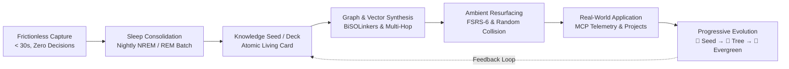
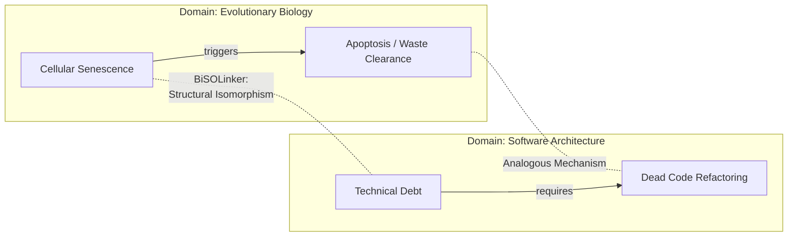
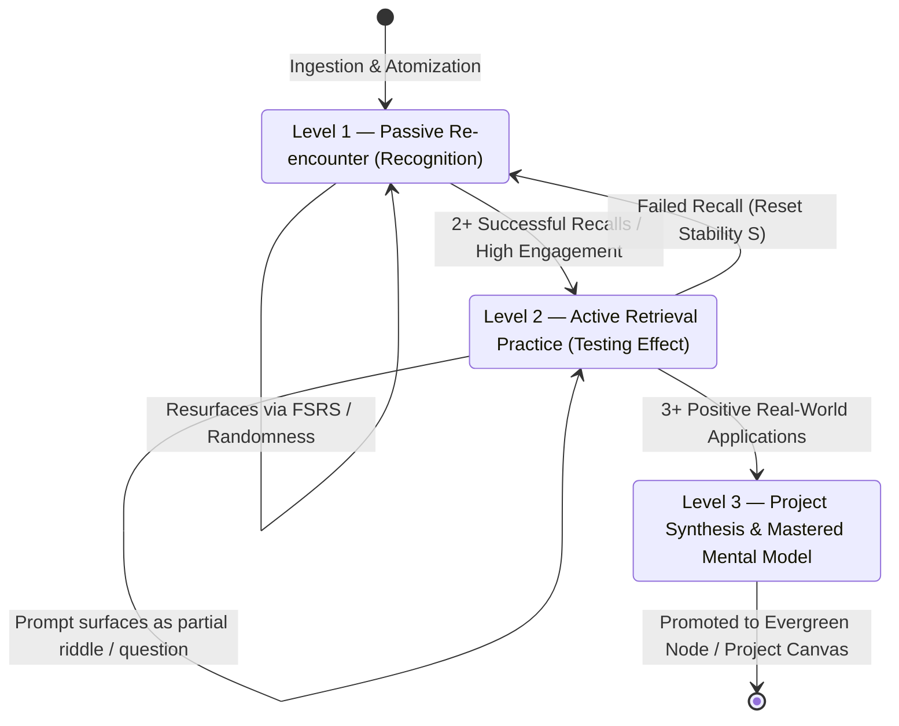
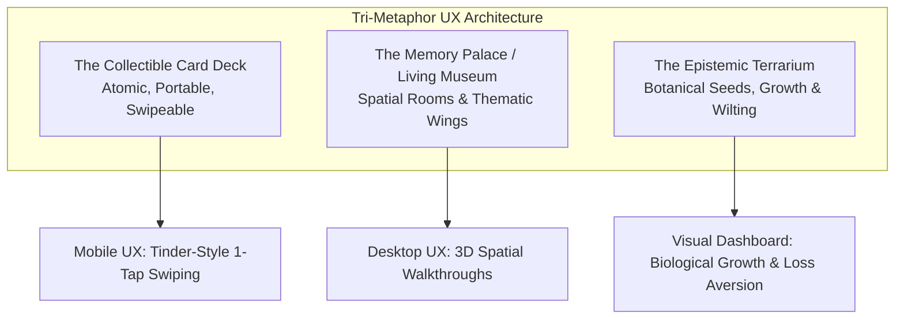

# The Symbiotic Knowledge Ecosystem: Architecting the Living Memory Engine and Serendipity Machine

> **Executive Summary:**  
> Traditional personal knowledge management (PKM) systems suffer from a fatal structural flaw: they optimize for *storage* rather than *retrieval* and *re-encounter*. This design failure forces users into administrative overhead, turns databases into digital graveyards, and accelerates cognitive offloading ("digital dementia").  
>  
> The **Symbiotic Knowledge Ecosystem (SKE)** resolves this crisis through a neuro-symbolic, biologically inspired architecture. Combining **GraphRAG**, the **Model Context Protocol (MCP)**, local large language models (LLMs), and adaptive spaced repetition (**FSRS-6**), the SKE decouples capture from organization. It captures multi-modal thoughts in under 30 seconds with zero manual friction, digests and atomizes notes during an overnight "sleep consolidation" cycle, and ambiently resurfaces ideas via **forced collision**, **curiosity loops**, and **context-aware triggers**. By replacing folders with visual epistemic gardens and collectible cards, the system transforms passive information storage into an evolving, compounding thinking partner.

---

## 1. The Core Philosophy & Cognitive Imperative

### 1.1 The Failure Mode of Traditional Note-Taking
Most note-taking applications (e.g., Notion, Obsidian, Apple Notes, Google Keep) operate as passive, write-only repositories. Their workflow follows a linear, administrative funnel:

$$\text{Capture} \longrightarrow \text{Organize (Manual Categorization)} \longrightarrow \text{Archive (Digital Graveyard)}$$

This architecture contradicts human neurobiology in three fundamental ways:
1. **The Retrieval Paradox:** Human memory does not function like a hard drive; it optimizes for dynamic reconstruction, associative linking, and contextual salience. Notes entered into hierarchical folders disappear from awareness unless deliberately queried—and users only search for concepts they already remember having saved.
2. **The Administrative Tax:** Requiring tags, folders, or formatting at the moment of capture triggers executive dysfunction, kills creative momentum, and creates friction that eventually leads to system abandonment ($B = \text{MAP}$, Fogg Behavior Model).
3. **Cognitive Offloading & Hippocampal Atrophy:** Relying on external storage without retrieval practice induces "digital dementia." Knowing an idea is safely searchable causes the brain to drop the neural trace, degrading biological long-term memory.

### 1.2 The Paradigm Shift: From Storage to Symbiosis
The Symbiotic Knowledge Ecosystem shifts the operational paradigm from passive storage to an active, living organism:

$$\text{Capture} \longrightarrow \text{Compress} \longrightarrow \text{Connect} \longrightarrow \text{Reappear} \longrightarrow \text{Apply} \longrightarrow \text{Evolve}$$



In this architecture, **forgetting is treated as raw material rather than a defect**. By exploiting the *spacing effect*, *desirable difficulty*, and the *generation effect*, the system actively strengthens biological memory while continuously generating novel intellectual connections.

### 1.3 Theoretical and Neurobiological Foundations
The architecture is grounded in seven pillars of cognitive science and behavioral psychology:

* **Information Gap Theory (Loewenstein):** Curiosity is an active, dopaminergic drive state triggered by an awareness of missing knowledge. The SKE frames past notes as ambient riddles, open loops, and conceptual puzzles rather than static text, sparking an intrinsic itch to remember.
* **Retrieval Practice & Testing Effect:** Passive re-reading creates an illusion of competence. The SKE enforces active recall before revealing full notes, stimulating synaptic plasticity and consolidating long-term traces.
* **The Zeigarnik Effect:** Unfinished tasks and unresolved questions occupy subconscious cognitive bandwidth. Presenting knowledge as "uncompleted quests" or conceptual tensions keeps ideas actively compounding in the background.
* **Arthur Koestler’s Bisociation:** Creative breakthroughs occur when two habitually incompatible matrices of thought collide. The SKE autonomously identifies distant structural isomorphisms across domains (e.g., distributed databases and mycelial fungal networks) to trigger serendipitous synthesis.
* **Dual-Coding Theory (Paivio):** Memory retention increases dramatically when verbal information is paired with visual representations. Every idea card is synthesized with an auto-generated visual anchor.
* **Self-Determination Theory (Deci & Ryan):** Sustainable daily engagement requires Autonomy, Competence, and Relatedness. Superficial gamification (points, badges) destroys intrinsic curiosity through the *overjustification effect*; the SKE uses narrative progression and botanical growth metaphors instead.
* **The Fogg Behavior Model ($B = \text{MAP}$):** To ensure habit formation under high cognitive load or ADHD, the "Ability" threshold is maximized by reducing capture friction to absolute zero.

---

## 2. Neuro-Symbolic System Architecture

The SKE integrates local AI models, knowledge graphs, vector spaces, and operating-system-level context into a unified neuro-symbolic engine.

```mermaid
graph TD
    subgraph Ingestion_Layer [Layer 1: Ingestion Engine (<30s)]
        V[Voice Memos / Whisper]
        S[Screenshots / Vision OCR]
        W[Web Share Sheet / Highlights]
        M[Telegram / WhatsApp Bots]
    end

    subgraph OS_Bridge [Model Context Protocol (MCP)]
        MCP[MCP Semantic Router]
        IDE[IDE / Code Telemetry]
        Browser[Browser / URL / App State]
    end

    subgraph Digestion_Consolidation [Layer 2: Sleep-Consolidated Engine]
        NREM[Digital NREM Phase:\nNoise Triage & Synaptic Pruning]
        REM[Digital REM Phase:\nBiSOLinkers & Generative Synthesis]
        LLM[Local Quantized LLMs\nOllama / vLLM / Apple Silicon]
    end

    subgraph Storage_Memory [Hybrid Memory Substrate]
        G_DB[(GraphRAG: Neo4j / FalkorDB\nMulti-Hop Relational Links)]
        V_DB[(Vector DB: Chroma / Milvus\nEmbeddings & Isomorphism)]
        FSRS[(FSRS-6 Scheduler\nRust / SQLite Memory Stability)]
    end

    subgraph Resurfacing_Compounding [Layers 3 & 4: Resurfacing & Compounding]
        Deck[Idea Deck / Swipe Interface]
        Collision[Forced Collision Engine]
        Terrarium[Epistemic Terrarium Interface]
        Bridge[Project Workspace Bridge]
    end

    Ingestion_Layer --> MCP
    OS_Bridge --> MCP
    MCP --> Digestion_Consolidation
    Digestion_Consolidation --> Storage_Memory
    Storage_Memory --> Resurfacing_Compounding
```

### 2.1 The Four Operational Layers
1. **Capture Layer (<30s, Zero Friction):** Format-agnostic ingestion that accepts voice, text, links, photos, and screenshots without requiring categorization, tags, or folder assignments.
2. **Digestion & Consolidation Layer:** An asynchronous, overnight batch process that normalizes, atomizes, tags, and evaluates raw inputs while pruning digital noise.
3. **Resurfacing & Retrieval Layer:** A dual-engine delivery system combining precision spaced repetition (**FSRS-6**) with weighted stochastic serendipity (random discoveries, forced collisions, context triggers).
4. **Compounding & Action Layer:** A bidirectional bridge linking captured concepts to real-world projects, habits, and written outputs, tracked via telemetry.

### 2.2 Component Specifications
| Architectural Component | Underlying Technology | Core Function in the SKE |
| :--- | :--- | :--- |
| **Ingestion Engine** | Local Whisper ASR, Apple Vision / Tesseract OCR | Frictionless multi-modal capture across desktop and mobile; normalizes audio, screenshots, and clippings to clean text in <10 seconds. |
| **Semantic Router** | Model Context Protocol (MCP) | Interconnects system state, active application data, file systems, URLs, and IDE context with local databases without manual copy-pasting. |
| **Relational Memory** | GraphRAG (Neo4j / FalkorDB) | Extracts entities, concepts, and explicit directional predicates ($A \xrightarrow{\text{causes}} B$); enables multi-hop reasoning across distant notes. |
| **Semantic Memory** | Vector Database (Chroma / Milvus / Qdrant) | High-dimensional dense embeddings for fuzzy concept retrieval, semantic clustering, and detecting cross-domain structural isomorphisms. |
| **Recall Scheduler** | FSRS-6 Algorithm (Compiled Rust / SQLite) | Models memory Difficulty ($D$), Stability ($S$), and Retrievability ($R$) to calculate the precise neurobiological threshold for review. |
| **Local Inference Stack** | Ollama / vLLM / llama.cpp | Executes quantized open-source LLMs locally for complete privacy, zero API latency, and offline operational autonomy. |

### 2.3 GraphRAG vs. Vector RAG: Why Vectors Alone Fail
Traditional personal knowledge systems that adopt AI rely heavily on Vector RAG (cosine similarity over embedding chunks). While effective for direct surface lookups, vector embeddings compress multi-dimensional conceptual relationships into linear averages. 

* **The Vector Failure:** If a user saves an insight on *cellular senescence* in biology and another on *code rot* in software engineering, vector similarity will often treat them as distant due to vocabulary divergence.
* **The GraphRAG Solution:** By extracting explicit semantic triplets ($\text{Code Base} \xrightarrow{\text{accumulates}} \text{Technical Debt} \xrightarrow{\text{causes}} \text{System Failure}$ and $\text{Organism} \xrightarrow{\text{accumulates}} \text{Senescent Cells} \xrightarrow{\text{causes}} \text{Tissue Degradation}$), GraphRAG traverses multi-hop connections. The system identifies that both concepts share an identical topological structure (**systemic degradation via unpruned metabolic waste**), creating a non-obvious cross-domain bridge.

---

## 3. The Sleep-Consolidated Maintenance Cycle

Biological brains do not forge complex conceptual schemas during waking hours; they capture raw fragments by day and consolidate them during sleep. The SKE replicates this circadian neurobiology through an automated, overnight **Sleep-Consolidated Architecture**.

```
  WAKING HOURS                     OVERNIGHT BATCH CYCLE                     MORNING STATE
┌──────────────┐             ┌─────────────────────────────────┐           ┌──────────────┐
│  Raw Ingest  │             │   DIGITAL NREM (Slow-Wave)      │           │    Daily     │
│  - Audio     │             │   • Synaptic Downscaling        │           │  Discovery   │
│  - Clips     │ ──────────> │   • Noise & Duplicate Pruning   │ ────────> │  • 1 Gem     │
│  - Photos    │             │   • Progressive Compression     │           │  • 1 Pair    │
│  - Text      │             │   ───────────────────────────   │           │  • 1 Quest   │
└──────────────┘             │   DIGITAL REM (Paradoxical)     │           └──────────────┘
                             │   • High-Temperature Synthesis  │
                             │   • BiSOLinker Scans            │
                             │   • Hybrid Seed Generation      │
                             └─────────────────────────────────┘
```

### 3.1 Digital NREM Phase (Slow-Wave Sleep): Synaptic Downscaling & Pruning
During periods of user inactivity, the system clears cognitive debris:
1. **Noise Triage:** Silently filters out ephemeral or low-value captures (e.g., parking stall photos, one-time verification codes, shipping tracking numbers) that entered the universal inbox.
2. **Duplicate Detection & Merging:** Compares new entries against the historical corpus. If an idea exhibits an $85\%+$ semantic overlap with an existing card, the AI flags it:
   > *"This concept overlaps $87\%$ with a note captured 8 months ago. Merging evidence and updating card health."*
3. **Progressive Compression:** Evaluates cards that have undergone multiple successful recall events, compressing them through structural abstraction:
   * **Stage 1 (Raw Capture):** 300 words of verbatim notes or transcripts.
   * **Stage 2 (Structured Card):** 100-word atomic thesis with bulleted supporting facts.
   * **Stage 3 (Core Concept):** 30-word distilled principle.
   * **Stage 4 (Aphorism):** A single punchy, memorable sentence.
   * **Stage 5 (Mental Model):** A universal metaphor or structural archetype.
4. **Active Suppression:** Automatically archives cards that have consistently received negative swipe feedback or remained completely untouched for extended periods, preventing the formation of an uncurated "digital graveyard."

### 3.2 Digital REM Phase: Generative Bisociation & Serendipity Synthesis
Once the graph is pruned, the local LLM increases its sampling temperature to initiate creative recombination:
1. **BiSOLinker Identification:** Arthur Koestler’s bisociative theory relies on finding concepts that bridge habitually incompatible domains. The engine scans distant clusters in vector space that share structural graph patterns.
2. **Synthetic Hypothesis Generation:** Pairs two semantically distant cards (e.g., *Roman Military Logistics* and *Distributed Database Consensus*) and formulates a generative collision question:
   > *"What core architectural principle of Byzantine fault tolerance is reflected in the logistics of Roman legionary grain distribution?"*
3. **Hybrid Seed Synthesis:** Packages these cross-domain collisions into "Daily Discoveries," primed to greet the user the following morning as an interactive curiosity loop.

---

## 4. End-to-End Workflows: Ingest, Digest, Recall, and Act

### 4.1 Ingestion Workflow (<30 Seconds, Zero Friction)
The iron rule of the capture layer: **Never organize while capturing. Organization kills momentum.**

* **Voice-First Input:** A dedicated OS-level shortcut, lock-screen widget, or hardware Action Button initiates audio recording within two seconds. Local Whisper transcribes the speech, preserving hesitations, emphasis, and emotional cadence.
* **Ambient Context Snapping via MCP:** When capturing via a browser extension or share sheet, MCP captures the active URL, video timestamp (down to the second for YouTube or podcast streams), highlighted text, and window title automatically.
* **Watched Screenshot Albums:** Any screenshot added to a designated album is processed asynchronously by local vision models. Text is extracted via OCR, diagrams are parsed into semantic descriptions, and visual metadata is logged.
* **Messaging Bot Ingestion:** Private Telegram or WhatsApp bots act as lightweight, multi-modal ingestion conduits requiring zero custom app overhead on mobile devices.

### 4.2 Digestion & Atomization Workflow
During digestion, raw inputs are transformed into **Atomic Idea Cards**:
* **Atomization Rule:** A 45-minute podcast capture is never stored as an unwieldy text dump; it is broken down into two or three distinct, self-contained idea cards.
* **Card Data Model:**
  * **Title:** Concise, declarative, punchy.
  * **Atomic Premise:** 1–3 clear sentences capturing the core insight.
  * **Context & Evidence:** Original source, timestamps, author, and specific examples.
  * **Multi-Dimensional Metadata:**
    * **Domain & Concept Tags:** Automatically generated ontology.
    * **Emotion Tag:** Emotional resonance at capture (🤯 *Mind-Blown*, 💡 *Useful*, ❤️ *Inspiring*, 🔥 *Must Apply*, 😂 *Humorous*, ⚡ *Contrarian/Skeptical*).
    * **Novelty vs. Resonance Scores:** Explicitly tracked as two independent metrics (1–10).
    * **Actionable Counterpart:** A direct behavioral implication ("What changes tomorrow?").

### 4.3 Organization Strategy: Semantic Graph, Not Folders
Hierarchical folders force a singular classification at capture time, introducing decision friction and obscuring cross-disciplinary relevance. The SKE uses a **bidirectionally linked, auto-clustering semantic graph**:
* Nodes represent atomic cards; edges represent explicit relationships (e.g., `supports`, `contradicts`, `analogous_to`, `implements`).
* Corrections made during daily review (e.g., rejecting an AI-suggested link) feed back into the local model's prompt context, refining future classification without requiring manual database administration.



### 4.4 Retrieval Modes
The system supports three user-initiated retrieval states:
1. **Semantic Search (Targeted Query):** Embedding-based natural language search capable of concept matching (e.g., searching *"how scarcity distorts attention"* immediately retrieves notes on *time-boxing* and *poverty economics*).
2. **Visual Graph Navigation (Associative Browsing):** Interactive 2D/3D cluster maps that allow users to visually explore adjacent concepts, bridge nodes, and semantic neighborhoods.
3. **Corpus-Grounded Socratic Assistant (Generative Dialogue):** An offline conversational agent strictly grounded in the user's personal knowledge base via RAG. It responds using the user's historical insights, highlighting past internal contradictions or thematic evolutions.

---

## 5. The Serendipity & Resurfacing Engine

The central failure of traditional spaced repetition (e.g., Anki, SuperMemo) in knowledge management is the "flashcard tax"—the feeling that daily review is an oppressive chore. The SKE reframes resurfacing as **ambient serendipity and effortless discovery**.

### 5.1 FSRS-6 Mathematical Scheduling
The Free Spaced Repetition Scheduler (version 6) abandons static intervals in favor of a machine-learning model calibrated to individual memory decay:
* **Difficulty ($D \in [1, 10]$):** The intrinsic cognitive complexity of the card.
* **Stability ($S$):** The time (in days) required for the probability of recall to drop to $90\%$.
* **Retrievability ($R(t) = (1 + \text{factor} \cdot \frac{t}{S})^{-\text{power}}$):** The real-time estimated probability of successful biological recall.

When $R$ declines toward the critical retention threshold (e.g., $R \approx 0.70$), the card is flagged for ambient re-encounter, catching the memory precisely when it is on the verge of biological decay.

### 5.2 Layered Resurfacing Mechanics
To prevent predictable review queues, the SKE integrates five distinct surfacing triggers:

```
┌────────────────────────────────────────────────────────────────────────┐
│                      DAILY RESURFACING PIPELINE                        │
│                                                                        │
│   ┌─────────────────────┐                    ┌─────────────────────┐   │
│   │ 1. FSRS Due Queue   │                    │ 2. Pure Random Card │   │
│   │ (Math Decay Model)  │                    │ (Serendipity Slot)  │   │
│   └──────────┬──────────┘                    └──────────┬──────────┘   │
│              │                                          │              │
│              └───────────────────┬──────────────────────┘              │
│                                  ▼                                     │
│                     ┌──────────────────────────┐                       │
│                     │ HARD CAP: 1-2 CARDS /DAY │                       │
│                     └────────────┬─────────────┘                       │
│                                  │                                     │
│     ┌────────────────────────────┼────────────────────────────┐        │
│     ▼                            ▼                            ▼        │
│ 3. Forced Collision      4. Context Trigger          5. Curiosity Loop │
│ (Weekly Pair Synthesis)  (Time / Geo / App State)    (Open Gap Riddle) │
└────────────────────────────────────────────────────────────────────────┘
```

1. **Scheduled Re-Exposure (Without Flashcard Fatigue):** Surfaced as a native notification framed as discovery: *"A thought from last October resurfaced: 'Systems degrade when feedback loops lag.' Still relevant?"*
2. **True Stochastic Serendipity (Intermittent Reinforcement):** One card is drawn daily completely at random, independent of FSRS scheduling. Emulating the psychological dynamics of variable rewards, this unpredictable surprise makes opening the application intrinsically motivating.
3. **Forced Cross-Domain Collision:** Once a week, the system pairs two structurally analogous but semantically distant cards, prompting the user with a generative question to spur combinatorial innovation.
4. **Context-Aware Ambient Triggers:** MCP monitors environmental context to surface cards where they are actionable:
   * Entering the gym $\rightarrow$ *"Progressive Overload Principle"* card.
   * Launching VS Code $\rightarrow$ *"Designing Resilient Async Pipelines"* card.
   * Calendar event indicating a team review $\rightarrow$ *"Radical Candor Feedback Model"* card.
5. **Curiosity Loops & Anomaly Challenges:** Instead of displaying the full note, the interface presents an intentional information gap: *"In April 2024, you identified a critical flaw in your caching architecture. Can you recall the bottleneck before reviewing the note?"*

---

## 6. Long-Term Memory Progression & Progressive Compression

To ensure that saved notes become durable mental models, cards advance through a **Three-Tier Progression Model**, paired with structured cognitive compression.



### 6.1 The Three-Tier Memory Progression
* **Level 1 (Passive Re-encounter — Recognition):** The card resurfaces naturally as a full, bite-sized insight. Re-reading the card resets the FSRS stability interval and reinforces baseline cognitive recognition.
* **Level 2 (Active Retrieval Practice — Testing Effect):** The system conceals the core thesis, presenting only the original context, a conceptual prompt, or a fill-in-the-blank challenge. Forcing biological retrieval prior to reveal triggers synaptic consolidation and halts "digital dementia."
* **Level 3 (Project Synthesis & Mental Model Mastery):** When a card repeatedly demonstrates high resonance and successful retrieval, the system prompts the user to integrate it into an active project or translate it into their own words. The card graduates into a permanent, bedrock mental model.

### 6.2 Progressive Compression in Action
Knowledge density should increase over time. As an idea matures through the system, the text shrinks while conceptual power expands:

$$\begin{array}{ccc}
\text{\textbf{Level}} & \text{\textbf{Form}} & \text{\textbf{Example Transformation}} \\
\hline
\text{Raw Capture} & \text{300-word excerpt} & \text{Transcript discussing how Roman roads enabled long-term empire governance.} \\
\text{Level 1 Card} & \text{100-word atomic note} & \text{Summary of physical infrastructure serving as a deterministic communication protocol.} \\
\text{Level 2 Card} & \text{30-word principle} & \text{"Governance scale is constrained by the latency of physical feedback loops."} \\
\text{Level 3 Model} & \text{1-sentence / Aphorism} & \text{"Bandwidth creates empires; latency destroys them."}
\end{array}$$

---

## 7. Action Pipeline, Project Bridge & Utility Scoring

A fundamental vulnerability of personal knowledge systems is the conflation of **epistemic novelty** (cheap entertainment) with **practical utility** (actionable value).

### 7.1 Novelty Score vs. Resonance Score
Every concept receives two decoupled ratings:
* **Novelty Score ($1 \to 10$):** Measures initial cognitive surprise at capture time. High novelty often reflects interesting trivia or radical claims.
* **Resonance Score ($1 \to 10$):** A rolling behavioral score determined by real-world interaction:
  * Swiping *"Still resonates"* during review increases the score.
  * Applying the concept in a code commit, essay, or active project yields a major boost.
  * Dismissing or swiping *"Meh"* reduces the score.

```
                  HIGH NOVELTY
                       │
       Curiosity       │     Breakthrough Mental Models
       Trivia          │     (PRIORITIZE IN SYSTEM)
       [Novel: 9, Res: 2]   │     [Novel: 8, Res: 9]
                       │
───────────────────────┼─────────────────────────── RESONANCE
                       │
       Digital Clutter │     Foundational Habits & Axioms
       (PRUNE IN NREM) │     [Novel: 2, Res: 9]
       [Novel: 1, Res: 1]   │
                       │
                  LOW NOVELTY
```

* **High Novelty / Low Resonance:** Fun facts that feel profound in the moment but yield zero behavioral or creative impact. The NREM sleep phase systematically prunes or archives these cards.
* **Low Novelty / High Resonance:** Foundational operational principles (e.g., *"Sleep 8 hours," "Write modular functions"*). Even though novelty is low, high resonance guarantees consistent, context-aware surfacing.

### 7.2 The Project Bridge
Active projects (e.g., *"Q3 Architecture Redesign," "Technical Writing Series"*) maintain dynamic semantic profiles. The system monitors these workspace descriptions via MCP:
* When writing or coding, the system silently queries the knowledge graph for cards relevant to the active cursor context.
* Suggested links appear non-intrusively in a desktop sidecar: *"You have 2 saved cards from 2024 that directly address this database locking issue."*

### 7.3 Action Hooks: "What Changes Tomorrow?"
Every high-value card prompts an actionable behavioral counterpart upon creation. If a user saves an insight on circadian rhythms, the card enforces an operational hook:
* *Theoretical Insight:* Adenosine accumulation drives sleep pressure; blue light inhibits melatonin.
* *Actionable Hook:* Set a phone alarm for 9:30 PM to turn off overhead LED lighting.

---

## 8. Interface Metaphors & Human Experience

Traditional folder trees and endless markdown lists create cognitive fatigue. The SKE transforms knowledge interaction into an engaging visual, spatial, and gamified experience.



### 8.1 The Tri-Metaphor System
Rather than forcing a single metaphor, the SKE integrates three complementary mental models:
1. **The Collectible Card Deck (Data Unit):** Atomic, visually striking cards with rarity borders based on novelty, auto-generated dual-coding illustrations, and punchy front/back summaries. This unit is optimized for quick mobile interaction.
2. **The Living Museum / Memory Palace (Spatial Exploration):** A spatial environment where knowledge clusters become architectural wings (e.g., *The Distributed Systems Gallery*, *The Cognitive Psychology Wing*). Users can navigate virtual rooms to explore adjacent concepts.
3. **The Epistemic Terrarium (Biological Growth & Retention):** The primary interface for tracking knowledge health.

### 8.2 The Apex Interface: Epistemic Terrariums
The Epistemic Terrarium models the knowledge base as a living, dynamic ecosystem:

* **Seeds (🌱):** Newly captured, unverified thoughts enter the terrarium as floating seeds containing raw notes.
* **Sprouts (🌿):** Successful Level 1 recall events cause the seed to germinate. The plant takes on domain-specific generative aesthetics:
  * *Computer Science / Math:* Rigid, crystalline, fractal geometric structures.
  * *Philosophy / Psychology:* Fluid, bioluminescent, meandering vines.
  * *History / Literature:* Deeply rooted, weathered, organic bark structures.
* **Trees (🌳):** Applying the idea to real-world projects or passing Level 2 retrieval prompts matures the sprout into an established tree.
* **Evergreens (🌲):** Level 3 mental models that have fundamentally altered user behavior become permanent, non-wilting features of the landscape.
* **Loss Aversion & Wilting Mechanics:** When FSRS retrievability ($R$) drops below $70\%$, the corresponding digital plant begins to wilt and lose its bioluminescence. This leverages natural loss aversion and the Zeigarnik effect: users feel an intrinsic desire to "water" the plant by completing a 15-second active recall challenge, restoring its vitality and reinforcing biological synaptic connections.
* **Overnight Cross-Pollination (Hybrid Seeds):** During the REM sleep cycle, the AI identifies two distant, healthy plants (e.g., *Biochemistry* and *Economics*) and cross-pollinates them. A glowing, mysterious **Hybrid Seed** appears in the terrarium. To crack the seed open, the user must answer an AI-generated synthesis question that bridges both fields.

### 8.3 Mobile vs. Desktop Experience
* **Mobile (Frictionless Daily Routine):**
  * One-touch floating capture widget on the lock screen / home screen.
  * Maximum of **1–2 ambient push notifications per day** to eliminate notification fatigue.
  * Gesture-driven interaction:
    * **Swipe Right:** *"Still resonates"* (Boosts stability $S$, schedules next review).
    * **Swipe Left:** *"Meh / Fade"* (Decreases resonance, moves toward quiet retirement).
    * **Swipe Up:** *"Bridge to Project"* (Pins card to active project canvas).
* **Desktop (Deep Synthesis & Research):**
  * Split-screen workspace: Active Document / Browser on the left; real-time GraphRAG recommendations and AI Socratic Partner on the right.
  * Interactive 3D visual graph view with cluster filtering, bridge-node highlighting, and pathfinding between disparate topics.

---

## 9. Comprehensive Tool Comparison Matrix

To understand why a unified Symbiotic Knowledge Ecosystem is required, consider how existing personal knowledge management tools compare across fundamental capabilities:

| Evaluation Metric | Apple Notes / Google Keep | Notion | Obsidian | Readwise / Reader | Mem.ai / Capacities | Classical Zettelkasten | **Symbiotic Knowledge Ecosystem (SKE)** |
| :--- | :--- | :--- | :--- | :--- | :--- | :--- | :--- |
| **Capture Latency** | Ultra-Fast (<5s) | Slow (15–30s, templates) | Moderate (Requires vault) | Fast (Highlights only) | Fast (<10s) | Slow (Pen & Paper index) | **Ultra-Fast (<5s, Voice/OCR/MCP)** |
| **Organization Overhead** | Low (Folders/Tags) | High (Database setup) | High (Manual linking) | Zero (Automated feeds) | Low (AI auto-tagging) | Extreme (Manual numbering) | **Zero (Autonomous GraphRAG)** |
| **Resurfacing Mechanics** | None (Graveyard) | None (Search-only) | Manual (Community plugins) | Algorithmic (Highlight queue) | Minimal (Context search) | Manual (Index following) | **FSRS-6 + Stochastic Discovery** |
| **Combinatorial Creativity** | None | None | Visual graph (Manual) | None | Weak (Surface similarity) | High (Slip-box branching) | **Autonomous (BiSOLinkers & REM)** |
| **Long-Term Memory Reinforcement** | None | None | None | Passive (Re-reading) | None | Moderate (Writing atomic notes)| **Active Retrieval (Testing Effect)** |
| **Action & Project Bridge** | None | High (Task DBs) | Moderate (Canvas/Tasks) | None | Weak | High (Project slip-boxes) | **Automated (MCP Workspace Hooks)** |
| **Noise Triage & Pruning** | None | Manual archiving | Manual pruning | Manual discarding | None | Manual discarding | **Automated (NREM Sleep Pruning)** |
| **Data Privacy & Ownership** | Cloud-tied | Proprietary Cloud | Local-First (Markdown) | Cloud-tied | Proprietary Cloud | 100% Offline Physical | **Local-First (Quantized LLM + MCP)** |

---

## 10. Quantitative Ecosystem Metrics

Traditional note-taking systems measure success through vanity metrics: *total notes stored*, *total words written*, or *graph node counts*. These metrics celebrate information hoarding. 

The SKE measures cognitive retention, conceptual compounding, and behavioral change:

$$\begin{array}{lll}
\text{\textbf{Metric}} & \text{\textbf{Formula / Data Source}} & \text{\textbf{Cognitive Meaning}} \\
\hline
\text{Recall Success Rate} & \frac{\text{Successful Level 2 Recalls}}{\text{Total Level 2 Challenges}} & \text{Measures true biological retention and anti-dementia efficacy.} \\
\text{Resonance Ratio} & \frac{\text{Swipe Right ("Resonates")}}{\text{Total Resurfaced Cards}} & \text{Tracks the signal-to-noise ratio of stored ideas over time.} \\
\text{Promotion Rate} & \frac{\text{Level 3 Graduations}}{\text{Total Level 1 Ingestions}} & \text{Measures the conversion rate of raw captures into durable mental models.} \\
\text{Graph Density Growth} & \frac{2 \times \text{Cross-Domain Edges}}{\text{Total Nodes} \times (\text{Total Nodes} - 1)} & \text{Demonstrates whether knowledge is compounding or arriving as isolated orphans.} \\
\text{Application Rate} & \text{MCP Telemetry Hits in Code/Docs} & \text{Validates real-world behavioral changes sparked by stored concepts.} \\
\text{Pruning Velocity} & \frac{\text{Archived / Compressed Cards}}{\text{Total Ingested Cards}} & \text{Demonstrates ecosystem health through the active clearing of cognitive noise.}
\end{array}$$

---

## 11. Mitigation of Potential Pitfalls & Failure Modes

| Potential Failure Mode | Root Cause | Structural Mitigation in the SKE |
| :--- | :--- | :--- |
| **Capture Friction Fatigue** | Requiring users to select folders, create tags, or format text at save time. | Strict separation of capture and organization: Zero input fields allowed during capture; all ontology and metadata extraction are deferred to background LLMs. |
| **Notification Exhaustion** | Review queues scaling linearly with capture volume, creating a backlog. | **Hard daily cap of 1–2 cards maximum**, regardless of how many notes were saved. Decouples capture volume from review burden. |
| **Graph Sprawl ("Hairball Effect")** | Accumulating thousands of interconnected nodes with no clear hierarchy or relevance. | NREM sleep phase performs synaptic downscaling, archiving low-resonance nodes and collapsing multi-step relationships. |
| **Algorithmic Confirmation Bias** | AI surfacing only concepts that reinforce the user's existing ideological beliefs. | Stochastic injection of contrarian nodes: The system deliberately pairs concepts with contradictory evidence or competing mental models. |
| **Cognitive Atrophy via Automation** | AI summarizing everything, removing the user's need to think deeply. | Enforcing the **Testing Effect**: Level 2 prompts require biological recall before displaying digital notes, preserving hippocampal engagement. |
| **Gamification Burnout** | Introducing arbitrary points, badges, or capture streaks that destroy intrinsic curiosity. | Applying Self-Determination Theory: Replacing arbitrary points with botanical terrarium health, where streaks reflect *retrieval engagement*, not capture volume. |

---

## 12. Phased Implementation Roadmap & Daily Cadence

Transitioning to an autonomous memory ecosystem should follow a structured, six-stage rollout to establish trust, calibrate machine-learning decay curves, and build consistent habits.

```
┌────────────────────────────────────────────────────────────────────────┐
│                        PHASED IMPLEMENTATION                           │
│                                                                        │
│   Phase 1 (Weeks 1-2): Universal Capture Ingestion (Telegram/Widgets)  │
│   Phase 2 (Weeks 3-4): Nightly Digestion & Atomization Pipeline        │
│   Phase 3 (Weeks 5-6): Ambient Resurfacing MVP & FSRS Calibration       │
│   Phase 4 (Months 2-3): GraphRAG & Sleep-Consolidated Bisociation      │
│   Phase 5 (Months 4-6): Project Bridge, MCP Telemetry & Terrarium UX   │
│   Phase 6 (Ongoing):   Autonomous Ontology Refactoring & Deep Symbiosis│
└────────────────────────────────────────────────────────────────────────┘
```

### 12.1 Implementation Phases
* **Phase 1 (Weeks 1–2) — Frictionless Universal Capture:** Configure a private Telegram bot, mobile lock-screen widgets, and desktop global hotkeys. Focus exclusively on capturing raw thoughts in <30 seconds without organizing.
* **Phase 2 (Weeks 3–4) — Asynchronous Digestion Pipeline:** Deploy local quantized models (e.g., via Ollama) and Whisper. Automatically convert daily raw inputs into structured, atomic idea cards overnight.
* **Phase 3 (Weeks 5–6) — Ambient Resurfacing MVP:** Activate daily notifications (hard-capped at 1–2 cards). Calibrate individual FSRS-6 stability curves using simple swipe gestures.
* **Phase 4 (Months 2–3) — GraphRAG & Sleep-Consolidated Bisociation:** Spin up Neo4j/FalkorDB and vector storage. Enable overnight NREM pruning and REM cross-domain forced collisions.
* **Phase 5 (Months 4–6) — Project Bridge & Epistemic Terrarium Interface:** Connect MCP hooks to IDEs, text editors, and browsers. Launch the visual terrarium interface to monitor knowledge health.
* **Phase 6 (Ongoing) — Lifelong Epistemic Symbiosis:** Continuous autonomous ontology refactoring, multi-year trend analysis, and deep Socratic conversation with the accumulated corpus.

### 12.2 Operational Cadence: User Routines vs. Autonomous System Actions

| Cadence | User Routine (< 5 min/day overhead) | Autonomous Background Engine Action |
| :--- | :--- | :--- |
| **Daily** | **Capture (<30s):** Dictate or clip insights instantly.<br>**Re-encounter (1–2 min):** React to 1–2 ambient cards via swipe gestures. | **Sleep Consolidation:** Nightly NREM noise pruning, duplicate resolution, and REM cross-domain bisociative synthesis. |
| **Weekly** | **Synthesis (10 min):** Review the weekly "Forgotten Gems" digest; tackle one forced-collision prompt between unrelated ideas. | **FSRS Calibration:** Re-weights memory stability and difficulty parameters across all active nodes based on the week's recall data. |
| **Monthly** | **Graduation Ritual (20 min):** Review Level 3 cards; convert high-resonance clusters into project drafts, articles, or habits. | **Synaptic Pruning:** Deep-archives low-resonance, un-retrieved cards to eliminate system entropy. |
| **Yearly** | **Ecosystem Retrospective (1–2 hours):** Explore the year's macro-intellectual shifts and top compounding mental models. | **Ontology Refactoring:** Reorganizes core high-level cluster taxonomies to match long-term evolutions in personal focus. |

---

## 13. Real-World End-to-End Scenarios

### Scenario A: The Commute Podcast Insight
1. **Ingest (07:35 AM):** While driving, a software engineer hears a podcast discuss *dopamine prediction errors* and habit formation. They tap their steering-wheel button: *"Idea: Dopamine spikes not on reward, but on unpredictable anticipation. Contrast with scheduled rewards."*
2. **Digest (Overnight):** Whisper transcribes the audio. The LLM atomizes it into a card: Title: *Dopamine Prediction Errors & Variable Reward*; Tags: *Neuroscience, Motivation, Behavioral Design*; Emotion: 💡 *Useful*.
3. **Connect (Nightly REM):** GraphRAG traverses semantic links and connects the note to an insight saved two years earlier regarding *intermittent database polling vs. push notifications*.
4. **Resurface (Day 18, 08:30 AM):** While drafting an architectural proposal for a user notification service, the engineer's desktop sidecar prompts: *"How does dopamine prediction error apply to the push-notification latency you are designing right now?"*
5. **Act (Day 18, 09:15 AM):** The engineer incorporates variable reward scheduling into the application architecture, permanently graduating the concept from a 🌱 *Seed* to an established 🌳 *Tree*.

### Scenario B: Breaking a Complex Architectural Deadlock
1. **The Block:** A system architect is stuck designing a Byzantine-fault-tolerant consensus mechanism for edge nodes operating under unstable network conditions.
2. **The Forced Collision:** The architect opens the SKE and requests a creative collision. The bisociative engine draws two structurally isomorphic nodes:
   * Node 1: *Mycelial fungal network resource distribution under localized environmental stress.*
   * Node 2: *Cryptographic gossip protocols.*
3. **The Socratic Synthesis:** The AI prompts: *"Mycelial cords re-route nutrients away from damaged hyphae without central coordination by relying purely on local hydrostatic pressure gradients. How would your gossip protocol behave if network partitions were treated as hydraulic resistance?"*
4. **The Breakthrough:** The lateral analogy reveals an alternative approach: implementing backpressure-based routing instead of explicit consensus voting, resolving the design deadlock.

### Scenario C: The YouTube Rabbit Hole & Overload Prevention
1. **The Risk:** Over a weekend, a user binges 14 lectures on ancient Roman logistics, saving 35 bookmarked clips, tweets, and screenshots. In a legacy system, this creates an intimidating 35-item backlog that leads to guilt and abandonment.
2. **The SKE Defense:**
   * **Noise Triage:** The NREM sleep phase analyzes the captures, identifying that 22 clips represent redundant points. It clusters them into 4 distinct core insights.
   * **Rate-Limited Resurfacing:** The daily delivery volume remains strictly capped at **1–2 cards per day**.
   * **Outcome:** Rather than facing a paralyzing wall of 35 notes, the user encounters the distilled insights smoothly over the subsequent two weeks, integrating the knowledge without cognitive overload.

---

## 14. The Apex Creative Vision: The Autonomous Socratic Thought Partner

If we strip away the traditional constraints of software interfaces—discarding buttons, search bars, and manual review queues entirely—the ultimate expression of the Symbiotic Knowledge Ecosystem is an **Autonomous Socratic Thought Partner**.

Imagine a companion that does not wait for you to type a search query. It lives quietly alongside your digital workspace, reading your notes, observing your projects via MCP, and reflecting on your accumulated knowledge like a thoughtful research colleague.

Once or twice a week, instead of an impersonal notification, you receive an audio voice memo spoken in a calm, curious tone:

> *"Hey—I was reviewing your notes from last week on distributed consensus, and I noticed something interesting. A year ago, you saved an insight from Daniel Kahneman arguing that human groups over-index on confident leaders during high-stress crises.*  
>  
> *Do you think your current consensus algorithm is making that exact same mistake by giving static priority to the fastest-responding node during a network partition? Or am I forcing a connection where one doesn't exist?"*

At this point, the tool ceases to be a notebook, a database, or a second brain. It becomes an **intellectual sparring partner**—a living, symbiotic cognitive extension that challenges your assumptions, protects your biological memory from atrophy, and ensures that no brilliant thought you encounter is ever truly forgotten.

---

## References and Theoretical Foundations
1. **Loewenstein, G.** (1994). *The psychology of curiosity: A review and reinterpretation.* Psychological Bulletin, 116(1), 75–98.
2. **Arthur Koestler.** (1964). *The Act of Creation.* Hutchinson & Co. (Foundational text on Bisociation and combinatorial creativity).
3. **Spitzer, M.** (2012). *Digital Dementia: What We and Our Children Are Doing to Our Minds.* Droemer Knaur.
4. **Karpicke, J. D., & Roediger, H. L.** (2008). *The critical importance of retrieval for learning.* Science, 319(5865), 966–968.
5. **Fogg, B. J.** (2009). *A behavior model for persuasive design.* Proceedings of the 4th International Conference on Persuasive Technology.
6. **Diekelmann, S., & Born, J.** (2010). *The memory function of sleep.* Nature Reviews Neuroscience, 11(2), 114–126.
7. **Paivio, A.** (1971). *Imagery and verbal processes.* Holt, Rinehart & Winston (Dual-Coding Theory).
8. **Deci, E. L., & Ryan, R. M.** (2000). *The "what" and "why" of goal pursuits: Human needs and the self-determination of behavior.* Psychological Inquiry, 11(4), 227–268.
9. **Open-Spaced-Repetition.** *FSRS-6 Algorithm Specification and Theory.* GitHub: `open-spaced-repetition/awesome-fsrs`.
10. **Anthropic.** *Model Context Protocol (MCP) Specification.* ModelContextProtocol.io.
11. **Microsoft Research.** *GraphRAG: Unlocking LLM discovery on narrative private data.* arXiv:2404.16130.
